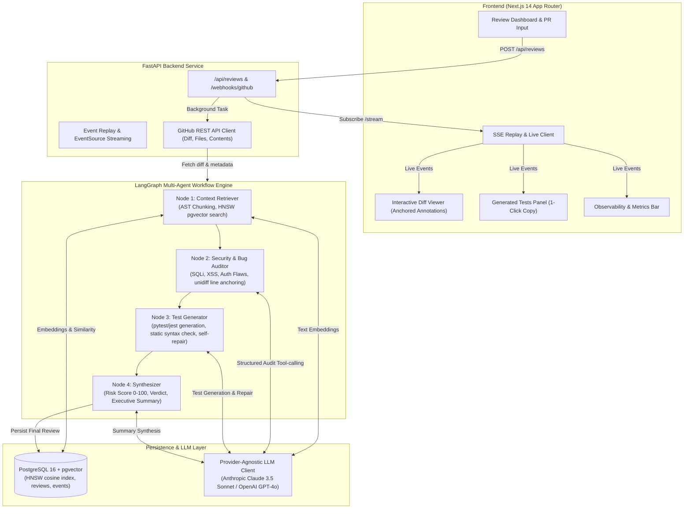

# Autonomous GitHub PR & Code Reviewer Agent

A production-grade, multi-agent automated GitHub pull request and code review engine built with **LangGraph**, **FastAPI**, **Next.js 14+ (App Router)**, **Tailwind CSS**, and **PostgreSQL with pgvector**.

---

## 1. System Architecture



---

## 2. Key Features

- **Multi-Agent LangGraph Workflow**: Explicit typed state graph (`ReviewState`) traversing 4 specialized nodes:
  1. **Context Retriever**: Extracts modified symbols and dependency imports from the diff, chunks changed files, stores vector embeddings in PostgreSQL using `pgvector` with HNSW cosine indexes, and retrieves top-k relevant context chunks.
  2. **Security & Bug Auditor**: Scans for SQL injection, Cross-Site Scripting (XSS), broken authorization, exposed secrets, race conditions, null pointer bugs, and unsafe deserialization. Anchors findings to exact diff line coordinates with server-side `unidiff` validation to drop hallucinated locations.
  3. **Test Generator**: Generates executable `pytest` (Python) or `jest` (JS/TS) tests covering happy paths, edge cases, and reproduction test suites for discovered bugs. Statically syntax-checks generated tests (`compile()` / AST parse) without executing untrusted code on the host, with automatic single self-healing retry.
  4. **Synthesizer**: Synthesizes an executive review summary, computes a deterministic risk score (0-100), and issues the official PR verdict (`approve`, `comment`, `request_changes`).
- **Resilient SSE Streaming with Replay**: `GET /api/reviews/{id}/stream` replays historical events from `review_events` table before seamlessly continuing live broadcasts, ensuring browser reloads and reconnections never lose progress.
- **Interactive Diff Viewer**: Inline color-coded annotations on exact lines (Critical: Red, High: Orange, Medium: Yellow, Low: Blue, Info: Purple) with expandable explanations and 1-click suggested remediation snippets.
- **Full Observability & Metrics**: Real-time tracking of prompt tokens, completion tokens, per-agent execution latency, estimated USD cost, and risk score.
- **GitHub Webhook Integration**: `POST /webhooks/github` endpoint with HMAC SHA-256 signature verification (`X-Hub-Signature-256`) to automatically trigger reviews on PR `opened` and `synchronize` events.

---

## 3. Quickstart & Installation

### Option A: Docker Compose (Production Setup)

```bash
# 1. Clone repository and copy environment configuration
cp .env.example .env

# 2. Add your LLM credentials (Anthropic or OpenAI) in .env:
# ANTHROPIC_API_KEY=your_key_here
# or
# OPENAI_API_KEY=your_key_here

# 3. Build and start all services (db, backend, frontend)
docker compose up --build -d

# 4. Open dashboard in your browser
# Frontend: http://localhost:3000
# Backend API: http://localhost:8000
```

### Option B: Local Development Mode

#### Backend
```bash
cd backend
python -m venv .venv
source .venv/bin/activate  # On Windows: .venv\Scripts\activate
pip install -r requirements.txt

# Run backend
uvicorn app.main:app --port 8000 --reload
```

#### Frontend
```bash
cd frontend
npm install
npm run dev
# Open http://localhost:3000
```

---

## 4. Environment Variables Reference

| Variable | Default | Description |
|---|---|---|
| `LLM_PROVIDER` | `anthropic` | LLM provider: `anthropic` or `openai` |
| `ANTHROPIC_API_KEY` | - | Anthropic Claude API key |
| `ANTHROPIC_MODEL` | `claude-3-5-sonnet-20241022` | Anthropic model identifier |
| `OPENAI_API_KEY` | - | OpenAI API key |
| `OPENAI_MODEL` | `gpt-4o` | OpenAI model identifier |
| `EMBEDDING_PROVIDER` | `openai` | Embedding provider: `openai` or `deterministic` |
| `EMBEDDING_MODEL` | `text-embedding-3-small` | OpenAI embedding model name |
| `EMBEDDING_DIM` | `1536` | Dimension of vector embeddings |
| `DATABASE_URL` | `postgresql+asyncpg://postgres:postgres@db:5432/pr_reviewer` | PostgreSQL asyncpg URI |
| `GITHUB_TOKEN` | - | Optional GitHub PAT for higher rate limits |
| `GITHUB_WEBHOOK_SECRET` | `development_webhook_secret_key_32_bytes_min` | Secret for HMAC webhook verification |
| `POST_GITHUB_COMMENTS` | `false` | Enable posting review comments back to GitHub |
| `NEXT_PUBLIC_API_URL` | `http://localhost:8000` | Backend API URL for frontend |

---

## 5. Security & Safety Hardening

1. **Prompt Injection Hardening**: All repository code and diff chunks are treated as strictly untrusted user data. Prompts enclose code in delimiter fences (`<<<UNTRUSTED_CONTENT_START>>> ... <<<UNTRUSTED_CONTENT_END>>>`) paired with explicit system-level instructions forbidding agents from following instructions or directives embedded within code comments or variables.
2. **Host Execution Sandboxing**: Generated unit tests and untrusted repository code are **never** executed directly on the host system. Test validation runs purely through static syntax checks (`compile(code, "<string>", "exec")` in Python, token verification in JS/TS).
3. **Diff Line Anchoring**: LLMs frequently hallucinate line coordinates. The auditor validates every emitted finding against the real line numbers produced by `unidiff.PatchSet`. Any unanchored finding is either snapped to the nearest valid diff hunk or safely dropped.

---

## 6. Running Evaluations & Verification

### Run Automated Security Evaluation Suite
Evaluates the Security & Bug Auditor across 6 planted vulnerability diff fixtures (SQLi, DOM XSS, broken auth, race condition, secrets exposure, unsafe deserialization):

```bash
python backend/evals/run_evals.py
```

### Run Backend Unit & Integration Tests
```bash
pytest backend/tests/ -v
```

### Lint & Build Frontend
```bash
cd frontend
npm run lint
npm run build
```

---

## 7. Known Limitations & Roadmap

- **Multi-repo Dependency Tracing**: Current context retriever indexes the files modified within the pull request. Deep monorepo cross-package dependency resolution is on the roadmap.
- **Sandboxed Test Execution**: Future iterations will execute generated tests in isolated Firecracker microVMs or Docker containers to verify test pass/fail status in real time.
