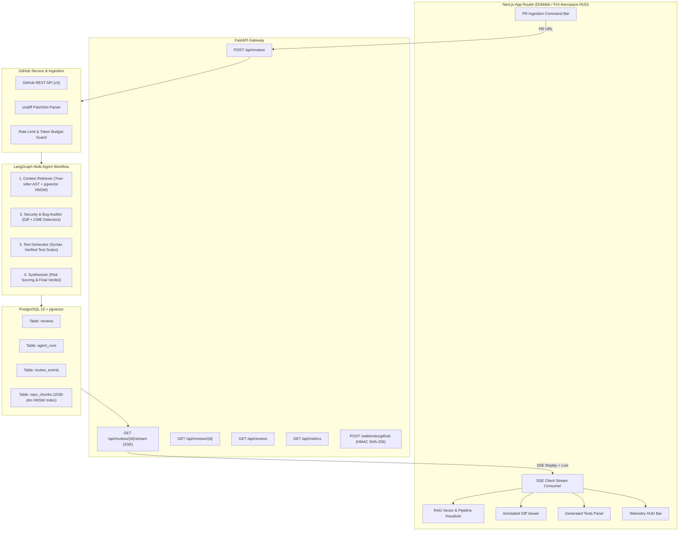

# Autonomous GitHub PR & Code Reviewer Agent: Architecture & System Design

Enterprise multi-agent code reviewer built with LangGraph, FastAPI, pgvector (PostgreSQL 16), Tree-sitter AST chunking, and Next.js 14+ (App Router).

---

## 1. System Overview & Scope

The Autonomous PR Reviewer automates pull request ingestion, contextual code understanding, vulnerability auditing, test reproduction generation, and review synthesis.

- **End-to-End Orchestration**: A 4-node LangGraph directed workflow coordinating Context Retrieval, Security & Bug Auditing, Test Generation, and Synthesis.
- **pgvector Semantic Retrieval**: Language-aware AST chunking (Tree-sitter) and 1536-dimensional dense embeddings (`text-embedding-3-small`) indexed with HNSW cosine distance (`<=>`).
- **Diff-Anchored Security Findings**: Only verified line coordinates from the unified diff are reported. Hallucinated lines and files outside the diff are stripped server-side.
- **Executable Test Suite Generation**: Generates reproduction pytest or Jest test suites and statically validates their syntax (`py_compile` / TS AST parse) without executing untrusted code on the host.
- **Real-Time Telemetry & SSE Replay**: Full server-sent events stream with sequence numbers and database replay to support page refresh without loss of progress.

---

## 2. End-to-End Architecture & Data Flow

---

## 3. LangGraph Workflow Nodes

1. **Context Retriever**:
   - Parses repository files using Tree-sitter for Python, TypeScript, and JavaScript.
   - Computes 1536-dimensional embeddings for AST syntax blocks.
   - Queries `repo_chunks` using pgvector HNSW cosine distance.
   - Combines vector similarity with AST import dependency tracing.

2. **Security & Bug Auditor**:
   - Scans unified diff and retrieved context for SQL injection, XSS, auth/authz flaws, secrets exposure, race conditions, and unsafe deserialization.
   - Anchors findings to exact diff line numbers, discarding unanchored hallucinations.

3. **Test Generator**:
   - Writes runnable pytest or Jest test cases covering happy paths, edge cases, and bug reproductions.
   - Statically validates syntax (`python -m py_compile`). Retries once with compiler diagnostics if syntax check fails.

4. **Synthesizer**:
   - Calculates severity score (0–100), overall risk evaluation, and verdict (`approve`, `comment`, `request_changes`).
   - Generates executive PR summary.

---

## 4. Security Hardening

- **Prompt Injection Defense**: All repository content and diff text are treated as untrusted data, enclosed in `<<<UNTRUSTED_CONTENT_START>>>` and `<<<UNTRUSTED_CONTENT_END>>>` delimiters with strict system prompt overrides.
- **No Untrusted Execution**: Generated tests and untrusted code are never executed on host environments.
- **HMAC Verification**: Webhooks enforce constant-time `hmac.compare_digest` with `sha256`.
