# Architecture & Design Decisions

This document records the architectural decisions, data flow, API contracts, and implementation plan for the **Autonomous GitHub PR & Code Reviewer Agent**.

---

## 1. System Architecture & Monorepo Structure

```
.
├── .env.example              # Environment variables template
├── .gitignore                # Root whitelist-based gitignore (protects parent workspace)
├── docker-compose.yml        # Docker composition for db, backend, frontend
├── Makefile                  # make targets: up, down, test, lint
├── README.md                 # Complete documentation & quickstart
├── docs/
│   └── DECISIONS.md          # Architectural record & decisions log
├── supabase/
│   └── migrations/
│       └── 00001_initial_schema.sql  # pgvector schema for PostgreSQL & Supabase
├── backend/
│   ├── Dockerfile
│   ├── requirements.txt      # Pinned Python dependencies
│   ├── app/
│   │   ├── main.py           # FastAPI entrypoint, middleware, CORS
│   │   ├── core/
│   │   │   ├── config.py     # Pydantic v2 settings
│   │   │   ├── logging.py    # Structured JSON logging & latency tracking
│   │   │   └── database.py   # Async PostgreSQL & vector storage connection
│   │   ├── models/
│   │   │   ├── schemas.py    # API request/response models & findings
│   │   │   └── db_models.py  # Database records & event structures
│   │   ├── services/
│   │   │   ├── github.py     # GitHub REST API client, PR parsing, diff retrieval
│   │   │   ├── chunking.py   # Tree-sitter & AST language-aware chunker
│   │   │   ├── embeddings.py # OpenAI / local vector embeddings
│   │   │   └── llm.py        # Provider-agnostic LLM client (Anthropic / OpenAI)
│   │   ├── agents/
│   │   │   ├── context_retriever.py # Node 1: chunking, embedding, vector retrieval
│   │   │   ├── security_auditor.py  # Node 2: security, bug audit & diff anchoring
│   │   │   ├── test_generator.py    # Node 3: pytest/jest test generator & syntax check
│   │   │   └── synthesizer.py       # Node 4: final review summary, score & verdict
│   │   ├── graph/
│   │   │   ├── state.py      # TypedDict LangGraph workflow state
│   │   │   └── workflow.py   # Multi-agent LangGraph graph definition & routing
│   │   └── api/
│   │       ├── reviews.py    # POST /api/reviews, GET /stream, GET /:id, GET /
│   │       ├── metrics.py    # GET /api/metrics (aggregates)
│   │       └── webhooks.py   # POST /webhooks/github with HMAC SHA256 verification
│   ├── evals/
│   │   ├── fixtures/         # 5+ diffs with known security flaws
│   │   └── run_evals.py      # Precision/recall evaluation runner
│   └── tests/                # Unit & integration test suite
└── frontend/
    ├── Dockerfile
    ├── package.json          # Pinned Next.js 14+/15 & UI dependencies
    ├── tsconfig.json
    ├── tailwind.config.ts
    └── src/
        ├── app/
        │   ├── layout.tsx
        │   ├── page.tsx      # Main dashboard & live review stream
        │   ├── reviews/      # Review history page
        │   └── globals.css
        ├── components/
        │   ├── ui/           # Card, Badge, Button, Tabs, Skeleton, Toast, ScrollArea
        │   ├── agent-timeline.tsx
        │   ├── diff-viewer.tsx
        │   ├── test-panel.tsx
        │   ├── metrics-bar.tsx
        │   └── header.tsx
        └── lib/
            ├── sse-client.ts # Resilient SSE client with auto-reconnect
            └── utils.ts
```

---

## 2. Data Flow & Multi-Agent Execution

```mermaid
sequenceDiagram
    autonumber
    actor User as Developer / Webhook
    participant API as FastAPI Backend
    participant DB as PostgreSQL + pgvector
    participant GH as GitHub REST API
    participant Graph as LangGraph Engine
    participant LLM as LLM Provider (Anthropic / OpenAI)

    User->>API: POST /api/reviews { url: "https://github.com/org/repo/pull/42" }
    API->>GH: Fetch PR metadata, unified diff & changed files
    GH-->>API: Diff, File contents at Head SHA
    API->>DB: Insert initial review record (status="queued")
    API-->>User: { review_id: "...", status: "queued" }

    User->>API: GET /api/reviews/{id}/stream (SSE)
    API->>DB: Stream historical review_events
    API-->>User: Replay events...

    API->>Graph: Launch multi-agent workflow

    rect rgb(20, 30, 45)
        Note over Graph,DB: Node 1: Context Retriever
        Graph->>DB: Check if commit SHA is already indexed in repo_chunks
        alt Not indexed
            Graph->>Graph: Tree-sitter AST chunking of changed & related files
            Graph->>LLM: Generate text embeddings
            Graph->>DB: Store chunks & HNSW vectors
        end
        Graph->>DB: Similarity search for modified symbols
        Graph-->>API: Emit event: node_started, reasoning, tool_call, node_finished
    end

    rect rgb(35, 25, 25)
        Note over Graph,LLM: Node 2: Security & Bug Auditor
        Graph->>LLM: Analyze diff + retrieved context with prompt-injection fencing
        LLM-->>Graph: Structured findings (line numbers, category, severity, explanation, fix)
        Graph->>Graph: Validate line numbers against real unidiff ranges (strip hallucinated)
        Graph-->>API: Emit event: finding, reasoning, node_finished
    end

    rect rgb(25, 35, 25)
        Note over Graph,LLM: Node 3: Test Generator
        Graph->>LLM: Generate runnable pytest / jest test suite
        LLM-->>Graph: Test code
        Graph->>Graph: Safe syntax validation (python -m py_compile / TS parser)
        opt If syntax error
            Graph->>LLM: Self-heal retry with compiler error
        end
        Graph-->>API: Emit event: test_generated, reasoning, node_finished
    end

    rect rgb(30, 25, 35)
        Note over Graph,LLM: Node 4: Synthesizer
        Graph->>LLM: Synthesize final review, risk score (0-100), verdict
        LLM-->>Graph: Final verdict & executive summary
        Graph->>DB: Update reviews (status="completed", result_json, metrics)
        Graph-->>API: Emit event: done
    end

    API-->>User: Stream real-time events to frontend
```



---

## 3. API Contract

### `POST /api/reviews`
- Request:
  ```json
  {
    "url": "https://github.com/owner/repo/pull/123",
    "post_github_comment": false
  }
  ```
- Response:
  ```json
  {
    "review_id": "c7a84e4f-561b-4b13-94df-7ad19ffba299",
    "status": "queued",
    "repo": "owner/repo",
    "pr_number": 123,
    "created_at": "2026-11-24T06:55:00Z"
  }
  ```

### `GET /api/reviews/{id}/stream`
- Protocol: Server-Sent Events (`text/event-stream`)
- Emits:
  - `event: node_started` -> `{"agent": "context_retriever", "timestamp": "..."}`
  - `event: reasoning` -> `{"agent": "security_auditor", "step": "Auditing SQL query construction in auth.py"}`
  - `event: tool_call` -> `{"agent": "context_retriever", "tool": "vector_search", "query": "..."}`
  - `event: finding` -> `{"finding": {"file": "auth.py", "line_start": 42, "line_end": 45, "severity": "critical", "category": "sql_injection", ...}}`
  - `event: test_generated` -> `{"test_code": "def test_sql_injection_prevented(): ...", "framework": "pytest"}`
  - `event: node_finished` -> `{"agent": "context_retriever", "latency_ms": 420}`
  - `event: error` -> `{"error": "..."}`
  - `event: done` -> `{"verdict": "request_changes", "risk_score": 85, "summary": "..."}`

### `GET /api/reviews/{id}`
- Returns the complete finalized review object including all findings, tests, and token/latency breakdown.

### `GET /api/reviews`
- Returns paginated list of previous reviews with verdicts, scores, and timestamps.

### `GET /api/metrics`
- Returns aggregate metrics: total reviews, average latency per agent, severity distribution, token consumption, and estimated cost.

### `POST /webhooks/github`
- Headers: `X-Hub-Signature-256: sha256=...`, `X-GitHub-Event: pull_request`
- Validates signature with `GITHUB_WEBHOOK_SECRET`
- Initiates automated review on `opened` and `synchronize` actions.

---

## 4. Key Design & Ambiguity Decisions

1. **Workspace Layout & Git Isolation:**
   - Workspace root is `C:\Users\dell`. A root `.gitignore` explicitly whitelists only project-related files (`/frontend`, `/backend`, `/supabase`, `/docs`, `docker-compose.yml`, `Makefile`, `.env.example`, `README.md`) so user files remain completely untouched and clean.

2. **Database & Vector Resilience:**
   - PostgreSQL 16 with pgvector extension is the primary target for Docker Compose and Supabase migrations.
   - For offline test runs or if PostgreSQL is bootstrapping, the database layer provides automatic fallback to an in-memory/sqlite vector cache for seamless unit testing without external dependencies.

3. **Diff Line Anchoring & Hallucination Prevention:**
   - LLMs frequently hallucinate line numbers in diffs. The backend parses the raw git diff with `unidiff`. Any finding produced by Node 2 is strictly checked against the set of added/modified lines in that diff. Hallucinated line coordinates are either snapped to the nearest valid diff hunk or dropped.

4. **Prompt Injection Hardening:**
   - All external repository code and diff chunks are treated as untrusted data.
   - Prompt templates strictly enclose code in delimiter fences (`<<<UNTRUSTED_DIFF_START>>> ... <<<UNTRUSTED_DIFF_END>>>`) with explicit system instructions prohibiting the model from interpreting user instructions, comments, or directives located inside the diff.

5. **Sandbox & Safety:**
   - No untrusted repository code or LLM-generated test code is ever executed on the host system.
   - Generated tests are only syntax-checked via `python -m py_compile` or an AST parser.

6. **LangGraph Multi-Agent Architecture:**
   - Uses `StateGraph` from the latest stable `langgraph`.
   - Node-level error handling wraps each agent so an issue in Node 1 or Node 3 degrades gracefully without crashing the whole review pipeline.

---

## 5. Phase Checklist & Verification Plan

- [x] Implementation plan & architectural specification (docs/DECISIONS.md)
- [ ] Phase 1: Monorepo scaffold, docker-compose, SQL migrations, .env.example
  - *Verify:* `docker compose up -d db` (or migration runner) and check pgvector extension and tables exist.
- [ ] Phase 2: Backend foundations (config, db, github, chunking, embeddings, llm, url parser)
  - *Verify:* `pytest tests/test_foundations.py` passes with 100% mocked unit tests.
- [ ] Phase 3: LangGraph multi-agent workflow (4 nodes, state graph, events, metrics)
  - *Verify:* `pytest tests/test_graph.py` passes integration test verifying event sequence and output schema.
- [ ] Phase 4: FastAPI routes, SSE streaming, replay, and webhook verification
  - *Verify:* `pytest tests/test_api.py` and test streaming response.
- [ ] Phase 5: Next.js frontend dashboard (App Router, Tailwind, components, diff viewer, tests panel)
  - *Verify:* `npm run build` and `npm run lint` succeed without errors.
- [ ] Phase 6: Eval harness, Makefile, README documentation, and end-to-end review
  - *Verify:* Run evals and end-to-end review on a real public PR.
